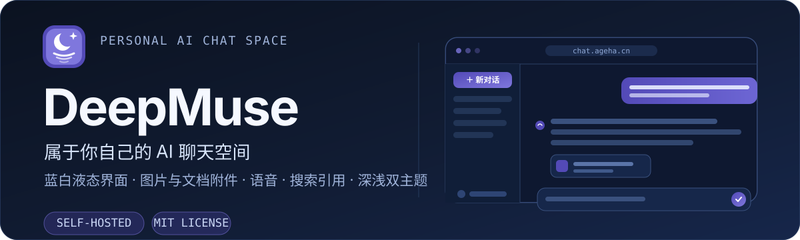
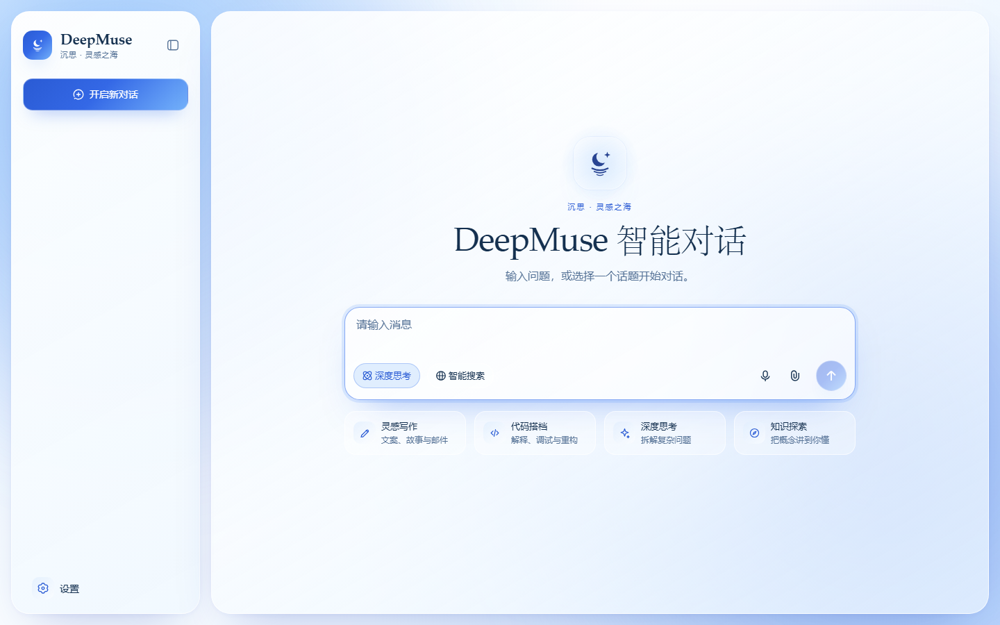
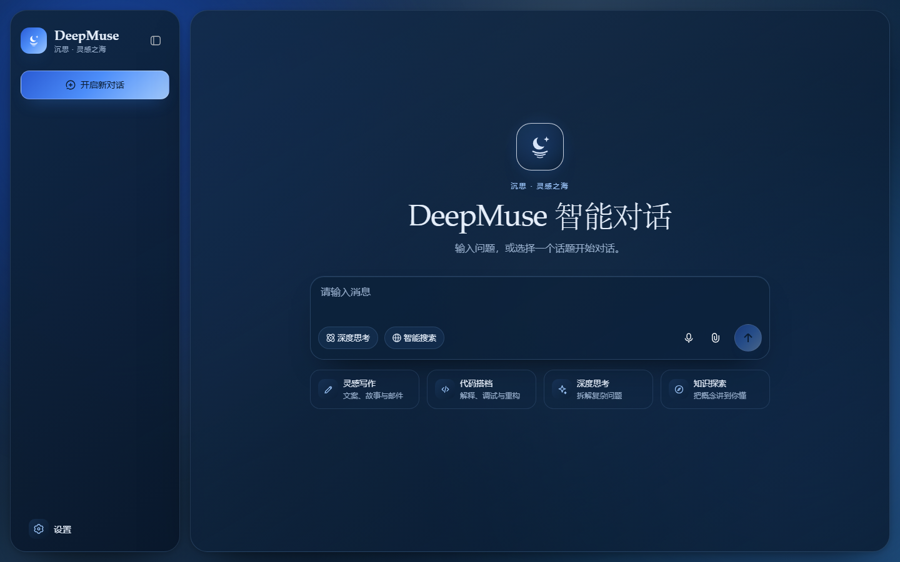
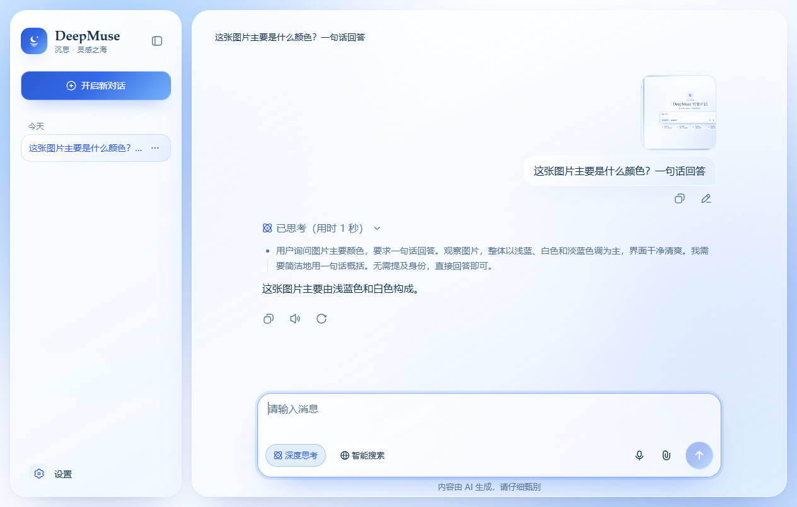
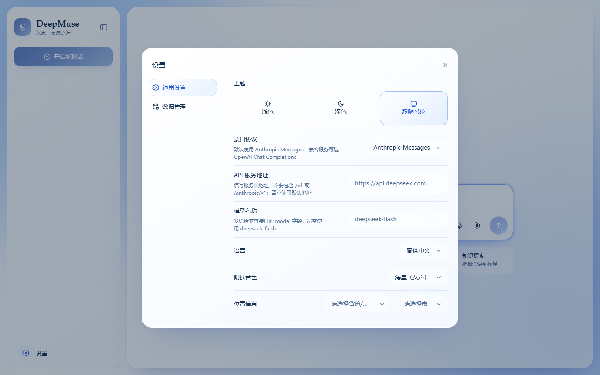

<p align="center">
  
</p>

<p align="center">
  <a href="https://chat.ageha.cn">Live demo</a> ·
  <a href="./README.zh-CN.md">简体中文</a> ·
  <a href="#quick-start">Quick start</a>
</p>

**DeepMuse** is a personal AI chat space — a polished, self-hostable web interface for the model of your choice. It started from DeepSeek's `chat-demo` and adds its own brand, a blue-and-white liquid interface, configurable API protocol / endpoint / model, inline image and document attachments, voice input and read-aloud, and a calm motion system.

No application database is required: conversations live in your browser, and the app talks directly to the configured API — or, in server mode, through a same-origin proxy that keeps the key on the server.

## See it

<table>
  <tr>
    <td width="50%"></td>
    <td width="50%"></td>
  </tr>
  <tr>
    <td width="50%"></td>
    <td width="50%"></td>
  </tr>
</table>

## What it does

- **Conversations** — multiple chats with automatic titles, rename and delete; edit a prompt, regenerate a reply, or switch between message branches.
- **Rich replies** — streaming output, deep thinking, smart search, link reading and source citations; stop generation or continue an eligible reply.
- **Attachments** — upload, paste or drag in files. Images are resized in-browser; DOCX / PPTX / XLSX and text formats are extracted locally, so no separate file-upload API is required.
- **Voice** — speech input and read-aloud, with a live audio spectrum above the input on mobile while recording.
- **Markdown** — syntax highlighting, KaTeX math and Mermaid diagrams.
- **Your way** — Simplified Chinese and English, light and dark themes, mobile layout, location settings, and ZIP import/export of chat history.

## Quick start

Requires Node.js 22.12+ and pnpm.

```sh
git clone https://github.com/Ageha6912/DeepMuse.git
cd DeepMuse
pnpm install
pnpm dev
```

Open http://localhost:8090, then set your API key under **Settings → Data → API Key**. The source defaults to the Anthropic Messages protocol with `https://api.deepseek.com` and model `deepseek-flash`; switch protocol, endpoint or model in **Settings → General** at any time. The endpoint is the server root — do not include `/v1` or `/anthropic/v1`.

To build the static site:

```sh
pnpm build
```

The output is in `dist/`. You can deploy it to any static host or open `dist/index.html` directly (that requires browser support for storage on `file://` pages and an API service that allows the corresponding cross-origin requests).

## Run with a server-side key

To let visitors chat without entering their own key, serve the app and proxy model requests from one Node process:

```sh
pnpm build:server
API_KEY=sk-your-key UPSTREAM_ORIGIN=https://api.deepseek.com MODEL=deepseek-flash pnpm start
```

The server hosts `dist/`, forwards `/api/*` to the upstream and injects the key — the browser never receives it. Set `DM_DEFAULT_PROTOCOL=openai` at build time for OpenAI Chat Completions upstreams. See [DEPLOY.md](DEPLOY.md) for deployment notes.

## How it works

```
Browser (React + TypeScript)
  ├── chat state & attachments ──► IndexedDB (local to your browser)
  ├── settings & API key ───────► localStorage (local to your browser)
  └── /api/* requests ──────────► Node proxy (optional) ──► upstream model API
```

- **Client-only mode** — the browser calls the configured API directly; there is no application backend.
- **Server mode** — the same-origin Node server forwards requests and injects the key, so visitors never handle credentials. The proxy does not log or store conversation content.
- **Attachments** are converted in the browser: images to inline `image_url` data, office documents and text files to plain text appended to the message. See [PERSONA.md](docs/PERSONA.md) for the assistant's behavioral spec.

## Data and privacy

Your API key and settings are stored in the browser's `localStorage`; conversations and original attachments are stored in `IndexedDB`. Local data is isolated by browser profile and site origin. Sending messages, uploading attachments and using speech features sends the relevant content to the configured API service — the service's own retention policy applies there.

History import/export in Settings uses ZIP archives. Importing replaces all local conversations and attachments after confirmation and validation; exports include conversations and locally available original images, but not API keys, settings or original non-image attachments. See [the archive format (Chinese)](src/services/chat/history/README.md) for details.

**Settings → Data → Delete all chats** clears all local conversations, original attachments and unsent drafts after confirmation. Your API key and settings are preserved; files already uploaded to the API service are not deleted.

## Development

| Command       | Description                  |
| ------------- | ---------------------------- |
| `pnpm dev`    | Start the development server |
| `pnpm build`  | Build into `dist/`           |
| `pnpm type`   | TypeScript type checks       |
| `pnpm lint`   | Lint with oxlint             |
| `pnpm format` | Format with oxfmt            |

[rspack.config.ts](rspack.config.ts) uses `https://api.deepseek.com` by default; `createConfig({ apiOrigin, devServer })` customizes the API origin and dev proxy. Speech features use ASR / TTS endpoints. Search, link reading and title generation use protocol extensions, so the configured service needs to support them.

```text
src/
  app/                 Layout, themes, global styles and keyframes
  assets/              Brand logo and mark (SVG)
  components/          Chat, settings, Markdown and UI primitives
  i18n/                English and Chinese copy
  services/
    api/               Requests, SSE, inline attachments, protocol types
    chat/              Conversations, branches, storage, import/export
    markdown/          Parsing, highlighting, diagrams
    speech/            Recording and read-aloud
  utils/               Shared helpers
```

## License

[MIT](LICENSE). The build copies the license to `dist/LICENSE`; include it when distributing the app. Third-party dependencies are subject to their own licenses.
