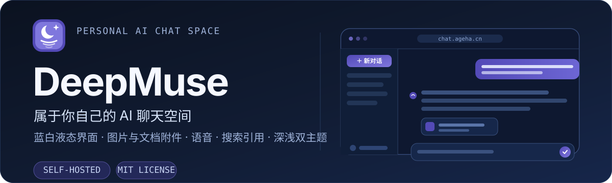
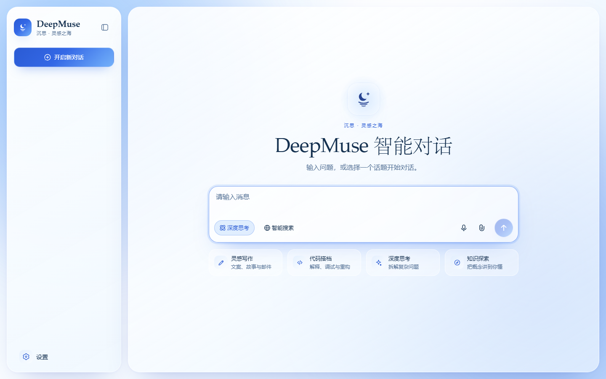
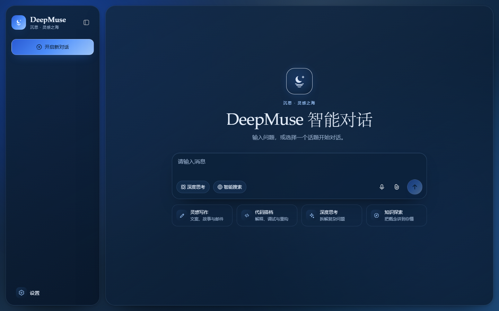
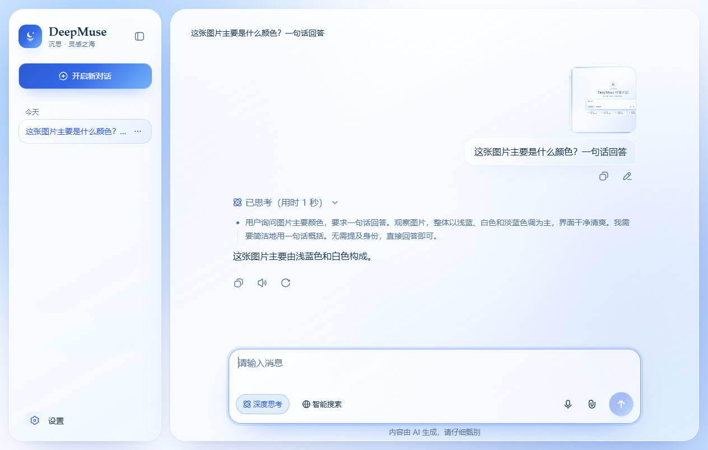
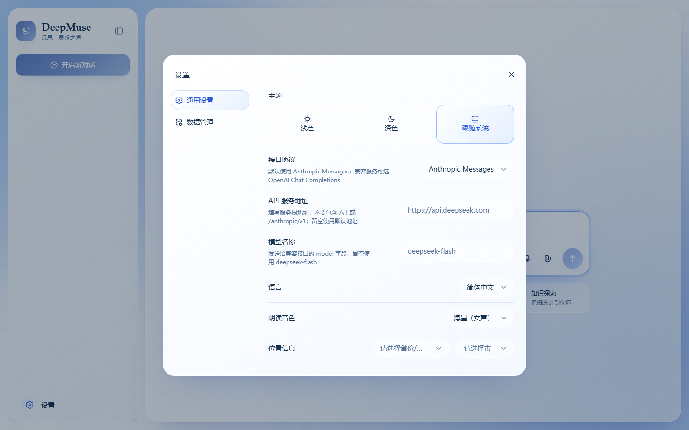

<p align="center">
  
</p>

<p align="center">
  <a href="https://chat.ageha.cn">在线体验</a> ·
  <a href="./README.md">English</a> ·
  <a href="#快速开始">快速开始</a>
</p>

**DeepMuse** 是一个属于你自己的 AI 聊天空间：一套可自托管、界面精致的网页，用来和你选择的模型对话。它基于 DeepSeek 的 `chat-demo` 二次开发，加入了独立品牌、蓝白液态界面、可配置的 API 协议 / 地址 / 模型、浏览器内处理的图片与文档附件、语音输入与朗读，以及克制的动效系统。

无需应用数据库：对话保存在你的浏览器里，页面直连配置的 API；也可以启用同源服务端代理，让密钥只留在服务器。

## 界面一览

<table>
  <tr>
    <td width="50%"></td>
    <td width="50%"></td>
  </tr>
  <tr>
    <td width="50%"></td>
    <td width="50%"></td>
  </tr>
</table>

## 它能做什么

- **多会话** — 自动标题、重命名与删除；编辑提问、重新生成、切换消息分支。
- **丰富回答** — 流式输出、深度思考、智能搜索、链接阅读与来源引用；支持停止和继续生成。
- **附件** — 上传、粘贴或拖拽文件。图片在浏览器内压缩；DOCX / PPTX / XLSX 及文本格式在本地提取，无需独立的文件上传接口。
- **语音** — 语音输入与回复朗读；移动端录音时输入框上方显示实时频谱。
- **Markdown** — 代码高亮、KaTeX 公式与 Mermaid 图表。
- **按你的习惯** — 中英文、浅色与深色主题、移动端布局、位置设置，以及 ZIP 格式的会话导入导出。

## 快速开始

需要 Node.js 22.12+ 与 pnpm。

```sh
git clone https://github.com/Ageha6912/DeepMuse.git
cd DeepMuse
pnpm install
pnpm dev
```

打开 http://localhost:8090，然后在「设置 → 数据管理 → API Key」填入密钥。源码默认使用 Anthropic Messages 协议、`https://api.deepseek.com` 和 `deepseek-flash` 模型；可随时在「设置 → 通用设置」切换协议、地址或模型。地址只需填写服务根地址，不要带 `/v1` 或 `/anthropic/v1`。

生成静态产物：

```sh
pnpm build
```

产物位于 `dist/`，可部署到任意静态服务器，也可直接打开 `dist/index.html`（需浏览器支持 `file://` 页面的存储，且 API 服务允许相应跨域请求）。

## 服务端托管密钥

如果希望访客不用自己填 Key，可用同源 Node 服务托管页面并代理模型请求：

```sh
pnpm build:server
API_KEY=sk-你的Key UPSTREAM_ORIGIN=https://api.deepseek.com MODEL=deepseek-flash pnpm start
```

服务会托管 `dist/`、把 `/api/*` 转发到上游并注入 Key，浏览器不会拿到它。上游若使用 OpenAI Chat Completions，构建时设置 `DM_DEFAULT_PROTOCOL=openai`。部署说明见 [DEPLOY.md](DEPLOY.md)。

## 工作原理

```
浏览器（React + TypeScript）
  ├── 会话与附件 ──────► IndexedDB（仅本地浏览器）
  ├── 设置与 API Key ──► localStorage（仅本地浏览器）
  └── /api/* 请求 ─────► Node 代理（可选）──► 上游模型 API
```

- **纯前端模式** — 浏览器直连配置的 API，没有应用后端。
- **服务端模式** — 同源 Node 服务转发请求并注入 Key，访客无需接触凭据；代理层不记录也不保存对话内容。
- **附件**在浏览器内转换：图片转为内联 `image_url`，Office 文档与文本文件提取为纯文本并入消息。助手的行为规范见 [PERSONA.md](docs/PERSONA.md)。

## 数据与隐私

API Key 和设置保存在浏览器 `localStorage`，会话及附件原件保存在 `IndexedDB`，本地数据按浏览器配置与站点源隔离。发送对话、上传附件或使用语音功能时，相应内容会提交给配置的 API 服务——该服务自身的保留策略同样适用。

设置中的历史导入导出使用 ZIP 格式。导入会在确认并校验成功后替换全部本地会话和附件；导出包含会话与本地可用的图片原件，不包含 API Key、设置或非图片附件原件。格式细节见[历史导入导出文档](src/services/chat/history/README.md)。

「设置 → 数据管理 → 删除所有对话」会在确认后清空全部本地会话、附件原件和未发送的草稿。API Key 与其他设置保留，已上传到 API 服务的文件不受影响。

## 开发

| 命令            | 用途                 |
| --------------- | -------------------- |
| `pnpm dev`      | 启动开发服务器       |
| `pnpm build`    | 构建到 `dist/`       |
| `pnpm type`     | TypeScript 类型检查  |
| `pnpm lint`     | 使用 oxlint 检查     |
| `pnpm format`   | 使用 oxfmt 格式化    |

[rspack.config.ts](rspack.config.ts) 默认连接 `https://api.deepseek.com`，`createConfig({ apiOrigin, devServer })` 可自定义 API 地址与开发代理。语音功能使用 ASR / TTS 接口，搜索、链接阅读与标题生成使用协议扩展，接入的服务需支持相应能力。

```text
src/
  app/                 布局、主题、全局样式与关键帧
  assets/              品牌标识与图形（SVG）
  components/          聊天、设置、Markdown 与基础组件
  i18n/                中英文文案
  services/
    api/               请求、SSE、内联附件、协议类型
    chat/              会话、分支、存储与导入导出
    markdown/          解析、代码高亮与图表
    speech/            录音与朗读
  utils/               通用工具
```

## 许可证

[MIT](LICENSE)。构建会将许可证复制到 `dist/LICENSE`，分发时请一并保留；第三方依赖遵循各自的许可证。
